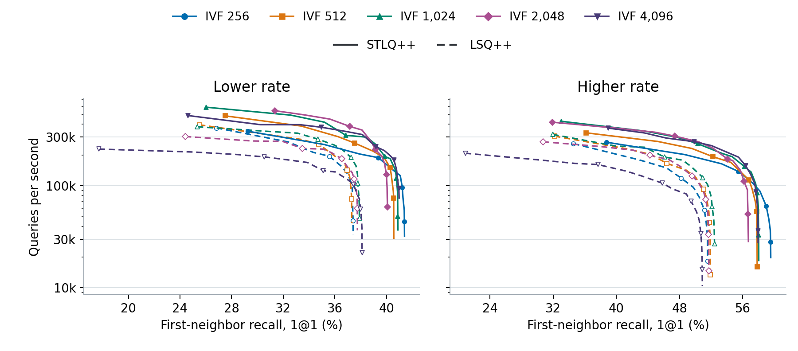
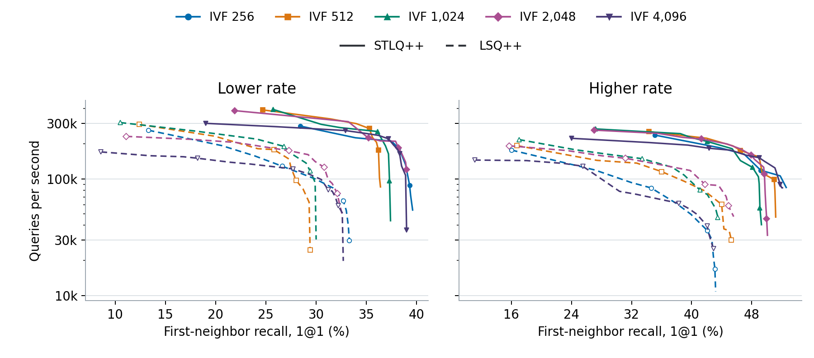
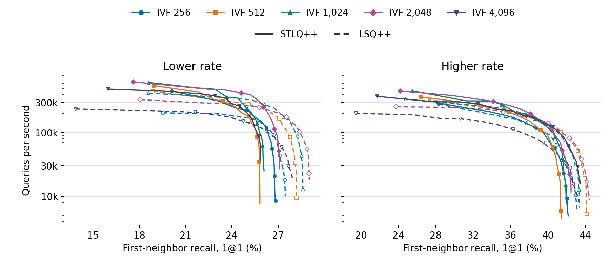
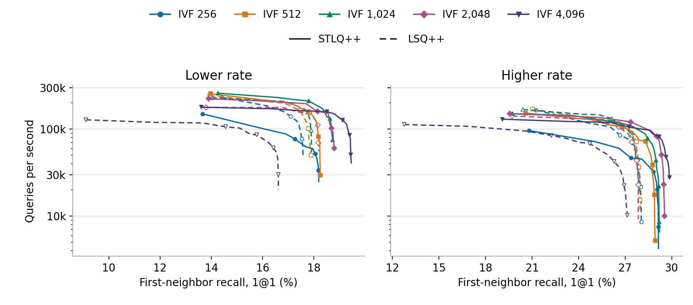

# IVF sensitivity in quantized search

Increasing the number of IVF lists can raise throughput at a given recall. The best list count depends on the dataset and the recall target. This sweep compares STLQ++ and LSQ++ on four datasets at two code rates, using quantized L2 scores. The throughput curves use `uncalibrated` scores. The full-probe recall tables report both uncalibrated and calibrated scores.

[SIFT1M](#sift1m) · [MSong](#msong) · [GloVe100](#glove100) · [Contriever1M](#contriever1m)

Each figure shows the lower and higher code rates side by side. Colors identify the five IVF list counts. Solid lines show STLQ++ and dashed lines show LSQ++. Points are Pareto-optimal measurements within each curve as the number of probed lists increases from 1 to at most 512 (256 for IVF256). Higher and farther right is better. QPS uses 32 CPU threads, exact IVF routing, one warm-up and the median of three timed runs. STLQ++ uses RSD2 and materialized parents.

The tables use a separate search over **all** IVF lists. **k'@k** is the mean percentage of the true top *k'* neighbors found among the first *k* results. Within each IVF setting, the two rows show scores before and after calibration. Paired values are **STLQ++ / LSQ++**. Bold marks the higher recall within each pair. Each method keeps its seed and coding recipe fixed across list counts. The reported bits per vector include IVF assignment and norm labels.

## SIFT1M

At the lower rate, the fastest measured STLQ++ point reaching 35% first-neighbor recall rises from 254k QPS at IVF256 to 449k at IVF2048, then falls to 339k at IVF4096. Uncalibrated full-probe 1@1 stays between 40.08% and 41.39% across the five settings.

### Lower rate · STLQ++ M6 / LSQ++ M9

| IVF lists | Scoring | Bits/vector | 1@1 (%) | 10@10 (%) | 50@50 (%) | 100@100 (%) |
|---:|---|---:|---:|---:|---:|---:|
| 256 | Uncalibrated | 88.35 / 88.00 | **41.39** / 37.42 | **52.33** / 47.40 | **58.31** / 53.40 | **60.91** / 56.08 |
| 256 | Calibrated | 88.35 / 88.00 | **42.25** / 38.01 | **53.46** / 48.34 | **59.59** / 54.74 | **62.23** / 57.53 |
| 512 | Uncalibrated | 89.67 / 89.00 | **40.57** / 37.32 | **52.42** / 47.69 | **58.36** / 53.88 | **60.87** / 56.49 |
| 512 | Calibrated | 89.67 / 89.00 | **41.17** / 38.22 | **53.47** / 48.78 | **59.64** / 55.24 | **62.22** / 57.89 |
| 1024 | Uncalibrated | 91.20 / 90.00 | **40.89** / 37.89 | **52.18** / 48.03 | **58.11** / 54.15 | **60.73** / 56.69 |
| 1024 | Calibrated | 91.20 / 90.00 | **41.38** / 38.48 | **53.21** / 49.16 | **59.39** / 55.44 | **62.03** / 58.13 |
| 2048 | Uncalibrated | 93.53 / 91.00 | **40.08** / 37.75 | **52.05** / 48.51 | **57.91** / 54.21 | **60.49** / 56.78 |
| 2048 | Calibrated | 93.53 / 91.00 | **40.80** / 38.35 | **53.15** / 49.53 | **59.18** / 55.56 | **61.77** / 58.16 |
| 4096 | Uncalibrated | 98.23 / 92.00 | **40.97** / 38.11 | **52.65** / 47.98 | **58.60** / 53.72 | **61.11** / 56.40 |
| 4096 | Calibrated | 98.23 / 92.00 | **41.59** / 38.69 | **53.72** / 48.96 | **59.76** / 55.02 | **62.31** / 57.78 |

### Higher rate · STLQ++ M10 / LSQ++ M17

| IVF lists | Scoring | Bits/vector | 1@1 (%) | 10@10 (%) | 50@50 (%) | 100@100 (%) |
|---:|---|---:|---:|---:|---:|---:|
| 256 | Uncalibrated | 152.93 / 152.00 | **59.55** / 51.55 | **68.85** / 61.20 | **73.39** / 66.04 | **75.19** / 68.12 |
| 256 | Calibrated | 152.93 / 152.00 | **59.88** / 52.15 | **69.64** / 62.16 | **74.15** / 67.20 | **75.99** / 69.35 |
| 512 | Uncalibrated | 154.47 / 153.00 | **57.83** / 51.90 | **68.73** / 61.30 | **73.19** / 66.35 | **74.98** / 68.43 |
| 512 | Calibrated | 154.47 / 153.00 | **58.59** / 52.68 | **69.44** / 62.38 | **74.03** / 67.50 | **75.83** / 69.63 |
| 1024 | Uncalibrated | 156.00 / 154.00 | **58.03** / 52.43 | **67.92** / 61.41 | **72.72** / 66.50 | **74.51** / 68.52 |
| 1024 | Calibrated | 156.00 / 154.00 | **58.63** / 52.68 | **68.66** / 62.52 | **73.55** / 67.64 | **75.38** / 69.69 |
| 2048 | Uncalibrated | 158.30 / 155.00 | **56.72** / 51.71 | **67.37** / 61.55 | **72.01** / 66.57 | **73.85** / 68.53 |
| 2048 | Calibrated | 158.30 / 155.00 | **57.43** / 52.37 | **68.16** / 62.62 | **72.85** / 67.66 | **74.71** / 69.75 |
| 4096 | Uncalibrated | 164.92 / 156.00 | **57.95** / 50.89 | **68.22** / 61.50 | **72.86** / 66.34 | **74.71** / 68.40 |
| 4096 | Calibrated | 164.92 / 156.00 | **58.47** / 51.63 | **68.94** / 62.41 | **73.61** / 67.48 | **75.50** / 69.60 |

## MSong

STLQ++ uses its reference LUT on MSong and LSQ++ uses its identity LUT. At the higher rate, uncalibrated STLQ++ recovers 64.41–64.76% of the true top ten across all five list counts. Its measured rate rises from 152.26 to 175.54 bits/vector between IVF256 and IVF4096.

### Lower rate · STLQ++ M5 / LSQ++ M9

| IVF lists | Scoring | Bits/vector | 1@1 (%) | 10@10 (%) | 50@50 (%) | 100@100 (%) |
|---:|---|---:|---:|---:|---:|---:|
| 256 | Uncalibrated | 87.29 / 88.00 | **39.60** / 33.20 | **53.84** / 46.64 | **61.25** / 54.88 | **64.52** / 58.34 |
| 256 | Calibrated | 87.29 / 88.00 | **39.60** / 24.60 | **53.97** / 39.16 | **61.19** / 48.06 | **64.45** / 51.71 |
| 512 | Uncalibrated | 89.61 / 89.00 | **36.40** / 29.40 | **53.34** / 46.53 | **61.52** / 55.37 | **64.60** / 58.85 |
| 512 | Calibrated | 89.61 / 89.00 | **36.70** / 25.10 | **53.38** / 39.60 | **61.33** / 48.70 | **64.47** / 52.18 |
| 1024 | Uncalibrated | 92.32 / 90.00 | **37.40** / 30.00 | **52.70** / 47.66 | **61.48** / 56.09 | **64.54** / 59.50 |
| 1024 | Calibrated | 92.32 / 90.00 | **37.60** / 24.60 | **52.80** / 40.37 | **61.38** / 49.01 | **64.46** / 52.63 |
| 2048 | Uncalibrated | 96.67 / 91.00 | **39.00** / 32.50 | **53.40** / 48.01 | **61.24** / 56.61 | **64.27** / 60.21 |
| 2048 | Calibrated | 96.67 / 91.00 | **39.40** / 26.90 | **53.28** / 40.28 | **61.14** / 49.43 | **64.22** / 53.28 |
| 4096 | Uncalibrated | 104.44 / 92.00 | **39.00** / 32.70 | **53.99** / 48.47 | **61.37** / 56.73 | **64.52** / 60.28 |
| 4096 | Calibrated | 104.44 / 92.00 | **39.00** / 27.60 | **54.11** / 40.86 | **61.31** / 49.60 | **64.37** / 53.52 |

### Higher rate · STLQ++ M10 / LSQ++ M17

| IVF lists | Scoring | Bits/vector | 1@1 (%) | 10@10 (%) | 50@50 (%) | 100@100 (%) |
|---:|---|---:|---:|---:|---:|---:|
| 256 | Uncalibrated | 152.26 / 152.00 | **52.50** / 43.20 | **64.41** / 57.40 | **70.55** / 64.64 | **73.09** / 67.43 |
| 256 | Calibrated | 152.26 / 152.00 | **52.50** / 35.10 | **64.53** / 48.15 | **70.49** / 56.45 | **73.09** / 59.57 |
| 512 | Uncalibrated | 155.14 / 153.00 | **51.20** / 45.20 | **64.76** / 57.32 | **70.90** / 64.94 | **73.03** / 67.92 |
| 512 | Calibrated | 155.14 / 153.00 | **51.40** / 34.70 | **64.66** / 48.70 | **70.82** / 56.57 | **73.06** / 60.03 |
| 1024 | Uncalibrated | 159.01 / 154.00 | **49.30** / 43.40 | **64.46** / 58.60 | **70.97** / 65.47 | **73.20** / 68.30 |
| 1024 | Calibrated | 159.01 / 154.00 | **49.70** / 34.40 | **64.31** / 49.16 | **70.92** / 56.99 | **73.22** / 60.12 |
| 2048 | Uncalibrated | 164.78 / 155.00 | **50.10** / 45.60 | **64.42** / 58.65 | **70.98** / 65.74 | **73.21** / 68.76 |
| 2048 | Calibrated | 164.78 / 155.00 | **50.80** / 34.80 | **64.50** / 49.86 | **70.92** / 57.36 | **73.18** / 60.70 |
| 4096 | Uncalibrated | 175.54 / 156.00 | **52.00** / 42.90 | **64.65** / 58.49 | **70.96** / 65.83 | **73.37** / 68.64 |
| 4096 | Calibrated | 175.54 / 156.00 | **52.70** / 33.80 | **64.60** / 49.53 | **70.99** / 57.37 | **73.37** / 60.56 |

## GloVe100

With uncalibrated scoring at the lower rate, LSQ++ has higher full-probe 1@1 at every list count, while STLQ++ recovers more of the true top ten at every list count. At the higher rate, uncalibrated STLQ++ top-ten overlap rises from 44.48% at IVF256 to 47.15% at IVF4096.

### Lower rate · STLQ++ M6 / LSQ++ M9

| IVF lists | Scoring | Bits/vector | 1@1 (%) | 10@10 (%) | 50@50 (%) | 100@100 (%) |
|---:|---|---:|---:|---:|---:|---:|
| 256 | Uncalibrated | 88.11 / 88.00 | 26.83 / **27.46** | **31.14** / 28.95 | **33.66** / 30.50 | **34.88** / 31.52 |
| 256 | Calibrated | 88.11 / 88.00 | 27.62 / **28.83** | **34.03** / 31.96 | **37.64** / 35.04 | **39.40** / 36.74 |
| 512 | Uncalibrated | 89.36 / 89.00 | 25.82 / **28.19** | **30.82** / 29.66 | **33.41** / 31.06 | **34.73** / 32.08 |
| 512 | Calibrated | 89.36 / 89.00 | 27.35 / **29.66** | **33.88** / 32.88 | **37.50** / 35.89 | **39.30** / 37.64 |
| 1024 | Uncalibrated | 91.10 / 90.00 | 26.12 / **28.61** | **31.02** / 30.03 | **33.43** / 31.56 | **34.70** / 32.52 |
| 1024 | Calibrated | 91.10 / 90.00 | 27.78 / **30.26** | **33.91** / 33.42 | **37.56** / 36.65 | **39.30** / 38.42 |
| 2048 | Uncalibrated | 93.72 / 91.00 | 27.11 / **29.02** | **30.97** / 30.67 | **33.60** / 32.16 | **34.84** / 33.13 |
| 2048 | Calibrated | 93.72 / 91.00 | 28.29 / **30.54** | 34.03 / **34.31** | **37.76** / 37.46 | **39.46** / 39.21 |
| 4096 | Uncalibrated | 97.57 / 92.00 | 25.90 / **28.00** | **30.51** / 30.09 | **33.33** / 31.70 | **34.58** / 32.65 |
| 4096 | Calibrated | 97.57 / 92.00 | 27.34 / **29.35** | 33.67 / **33.69** | **37.51** / 37.07 | **39.35** / 38.73 |

### Higher rate · STLQ++ M12 / LSQ++ M17

| IVF lists | Scoring | Bits/vector | 1@1 (%) | 10@10 (%) | 50@50 (%) | 100@100 (%) |
|---:|---|---:|---:|---:|---:|---:|
| 256 | Uncalibrated | 151.77 / 152.00 | 42.17 / **43.09** | 44.48 / **44.95** | **46.46** / 46.38 | **47.49** / 47.28 |
| 256 | Calibrated | 151.77 / 152.00 | **46.59** / 45.06 | **50.93** / 48.91 | **53.81** / 51.44 | **55.14** / 52.86 |
| 512 | Uncalibrated | 153.94 / 153.00 | 41.43 / **44.12** | **45.08** / 45.00 | 46.77 / **46.89** | 47.79 / **47.84** |
| 512 | Calibrated | 153.94 / 153.00 | 45.85 / **46.45** | **51.12** / 49.07 | **53.93** / 52.17 | **55.25** / 53.63 |
| 1024 | Uncalibrated | 156.95 / 154.00 | 41.99 / **43.40** | 45.44 / **45.68** | 47.24 / **47.39** | 48.20 / **48.31** |
| 1024 | Calibrated | 156.95 / 154.00 | **46.22** / 46.00 | **51.26** / 49.98 | **54.16** / 52.91 | **55.48** / 54.32 |
| 2048 | Uncalibrated | 162.00 / 155.00 | 42.55 / **44.47** | 46.30 / **46.50** | **48.17** / 47.77 | **49.11** / 48.68 |
| 2048 | Calibrated | 162.00 / 155.00 | 46.34 / **46.85** | **51.79** / 50.73 | **54.55** / 53.47 | **55.81** / 54.90 |
| 4096 | Uncalibrated | 169.85 / 156.00 | **43.60** / 43.50 | **47.15** / 46.28 | **48.90** / 47.62 | **49.83** / 48.49 |
| 4096 | Calibrated | 169.85 / 156.00 | **47.23** / 46.38 | **52.19** / 50.64 | **54.88** / 53.33 | **56.17** / 54.71 |

## Contriever1M

At the higher rate and a 25% first-neighbor recall target, the fastest measured STLQ++ point rises from 72k QPS at IVF256 to 135k at IVF2048. At the same target LSQ++ peaks at IVF1024 (147k QPS). STLQ++ reaches its highest uncalibrated full-probe 1@1 at IVF4096 in both rate tiers.

### Lower rate · STLQ++ M6 / LSQ++ M9

| IVF lists | Scoring | Bits/vector | 1@1 (%) | 10@10 (%) | 50@50 (%) | 100@100 (%) |
|---:|---|---:|---:|---:|---:|---:|
| 256 | Uncalibrated | 87.84 / 88.00 | **18.19** / 17.57 | **17.79** / 15.63 | **17.80** / 15.03 | **17.80** / 14.90 |
| 256 | Calibrated | 87.84 / 88.00 | 15.35 / **15.97** | **16.93** / 14.84 | **17.72** / 14.56 | **17.88** / 14.54 |
| 512 | Uncalibrated | 89.75 / 89.00 | **18.23** / 17.89 | **18.15** / 15.62 | **18.28** / 15.02 | **18.16** / 14.86 |
| 512 | Calibrated | 89.75 / 89.00 | 16.20 / **16.50** | **17.34** / 14.77 | **18.30** / 14.55 | **18.43** / 14.50 |
| 1024 | Uncalibrated | 91.97 / 90.00 | **18.72** / 17.91 | **18.39** / 15.92 | **18.22** / 15.11 | **18.07** / 14.88 |
| 1024 | Calibrated | 91.97 / 90.00 | 16.26 / **16.64** | **17.56** / 15.35 | **18.24** / 14.93 | **18.38** / 14.81 |
| 2048 | Uncalibrated | 95.45 / 91.00 | **18.79** / 18.18 | **18.28** / 15.92 | **18.29** / 15.17 | **18.11** / 15.01 |
| 2048 | Calibrated | 95.45 / 91.00 | 16.57 / **17.52** | **17.57** / 15.65 | **18.49** / 15.14 | **18.61** / 15.01 |
| 4096 | Uncalibrated | 101.92 / 92.00 | **19.46** / 16.62 | **18.63** / 14.80 | **18.39** / 14.18 | **18.14** / 13.98 |
| 4096 | Calibrated | 101.92 / 92.00 | **17.53** / 15.54 | **18.08** / 14.29 | **18.64** / 13.95 | **18.60** / 13.90 |

### Higher rate · STLQ++ M12 / LSQ++ M17

| IVF lists | Scoring | Bits/vector | 1@1 (%) | 10@10 (%) | 50@50 (%) | 100@100 (%) |
|---:|---|---:|---:|---:|---:|---:|
| 256 | Uncalibrated | 151.96 / 152.00 | **29.15** / 28.04 | **26.21** / 22.70 | **25.02** / 20.75 | **24.45** / 20.11 |
| 256 | Calibrated | 151.96 / 152.00 | **26.92** / 26.04 | **25.93** / 21.96 | **25.39** / 20.59 | **25.01** / 20.14 |
| 512 | Uncalibrated | 154.36 / 153.00 | **28.93** / 27.97 | **26.70** / 22.78 | **25.38** / 20.74 | **24.80** / 19.92 |
| 512 | Calibrated | 154.36 / 153.00 | **26.93** / 26.03 | **26.57** / 21.94 | **26.11** / 20.56 | **25.75** / 20.02 |
| 1024 | Uncalibrated | 156.11 / 154.00 | **29.22** / 27.89 | **26.90** / 22.83 | **25.28** / 20.52 | **24.64** / 19.72 |
| 1024 | Calibrated | 156.11 / 154.00 | **27.28** / 25.82 | **26.63** / 21.90 | **26.08** / 20.32 | **25.70** / 19.81 |
| 2048 | Uncalibrated | 159.20 / 155.00 | **29.53** / 27.85 | **26.52** / 22.76 | **24.90** / 20.45 | **24.25** / 19.59 |
| 2048 | Calibrated | 159.20 / 155.00 | **26.74** / 26.06 | **26.48** / 22.03 | **25.85** / 20.38 | **25.54** / 19.86 |
| 4096 | Uncalibrated | 167.64 / 156.00 | **29.84** / 27.17 | **27.01** / 21.87 | **25.22** / 20.01 | **24.47** / 19.26 |
| 4096 | Calibrated | 167.64 / 156.00 | **27.67** / 26.00 | **26.88** / 21.60 | **26.05** / 20.15 | **25.60** / 19.59 |
