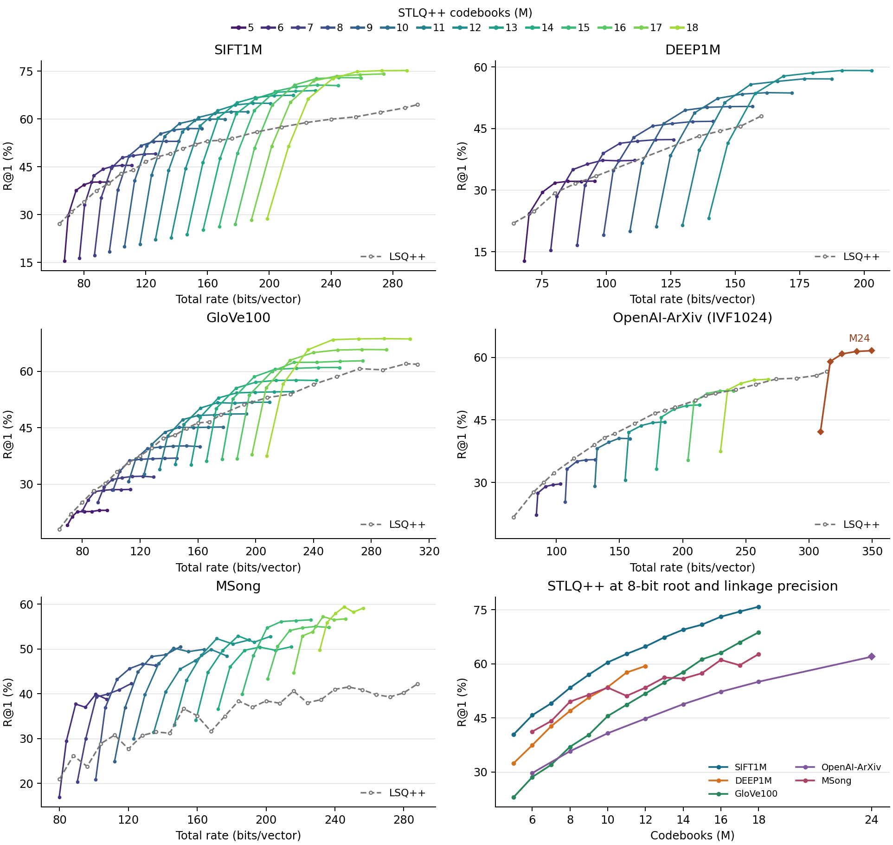
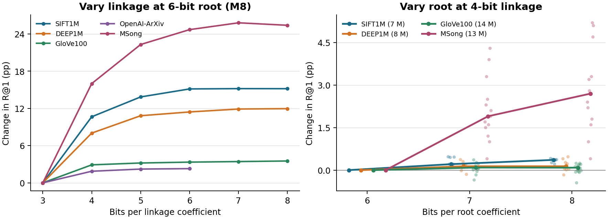
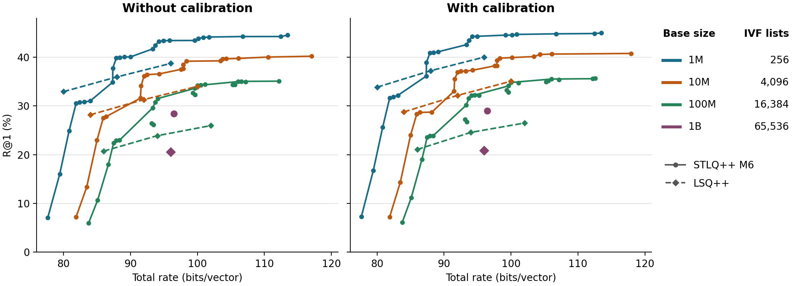

# Choosing code length and coefficient precision

STLQ++ spends bits on both codeword indices and their coefficients. Increasing the number of codebooks, **M**, gives the encoder more codeword combinations. Increasing coefficient precision adjusts the weights on the codewords already selected. At a fixed storage budget, these two choices compete.

## Reading the rate–recall curves

**Figure 1.** Each colored curve follows one STLQ++ model and forest through a sweep of linkage widths, with root coefficients fixed at 6 bits. Diamonds mark the additional M24 measurements on OpenAI-ArXiv. The gray dashed line shows LSQ++ across code lengths. The horizontal axis gives the reported total bits per base vector, including the norm label and IVF assignment. The final panel fixes both STLQ++ coefficient widths at 8 bits and varies M. Markers show measured configurations.

At coarse precision, increasing M generally shifts the rising part of the curve to the right. The curves look roughly like horizontal translations on SIFT and DEEP. On GloVe and OpenAI-ArXiv the flat sections appear earlier, and the rising sections also shift upward. Once a curve flattens, finer coefficients buy little additional recall on that forest. A larger M can reach a higher recall if the budget leaves room for its coefficients. As root reconstructions improve, fewer nodes can lower their reconstruction MSE by taking a parent, and the resulting drop in the linked-node ratio can temper the relative gain in peak recall.

**Read vertically at the intended budget.** On DEEP near 145 bits/vector, M8 with 8-bit linkage reaches 46.77% R@1 at 141.41 bits. M10 with 5-bit linkage reaches **52.36% at 143.24 bits**, while M12 with 3-bit linkage reaches 41.50% at 147.14 bits. Here M10 spends enough bits on both parts of the representation.

### Why does STLQ++ pull ahead at higher rates on OpenAI-ArXiv and GloVe?

On OpenAI-ArXiv, STLQ++ trails LSQ++ near 98 bits/vector (29.48% vs. 32.30% R@1). At 256.57 bits, M18 reaches **54.56%**, ahead of LSQ++ at 258 bits (53.51%). M24 reaches **59.00% at 316.87 bits** with 3-bit linkage coefficients; the nearest LSQ++ measurement is 56.59% at 314 bits. On GloVe, STLQ++ likewise trails near 96 bits (29.21% vs. 30.22%) and leads near 256 bits (68.42% vs. 58.56%).

These curves are consistent with a trade-off in directional resolution. At low rates, assigning bits to coefficients leaves fewer codeword indices to specify a direction. A larger budget can pay for both a richer set of directions and the coefficient precision needed to refine them along the linkage.

### Does a second set of codebooks explain the GloVe result?

STLQ++ M18 uses 18 root codebooks and 18 linkage codebooks. Each node uses the set for its role. On this GloVe100 forest, **95.94% of base vectors** are linked and reuse a parent's reconstruction. To test the effect of extra codebooks at a fixed LSQ++ rate, we split the 256 IVF lists into two groups of 128 with roughly equal training populations. We trained a separate LSQ++ M28 model for each group. A vector's list selects its model, keeping its code at 28 bytes. All 10,000 queries searched the full base.

| Model | Total bits/vector | Shared parameters (MiB) | R@1 (%) | Calibrated R@1 (%) |
|---|---:|---:|---:|---:|
| LSQ++ M28, one model | 240.00 | 2.83 | 54.15 | 56.53 |
| LSQ++ M28, two local models | 240.00 | 5.57 | 53.48 | 56.40 |
| STLQ++ M18, 6-bit root / 4-bit linkage | 236.27 | 3.55 | **63.59** | **65.75** |

In this single-seed comparison, doubling the LSQ++ codebooks left calibrated R@1 nearly unchanged. The two local models together used more shared parameter memory than STLQ++, yet trailed it by **9.35 percentage points**. Extra codebook capacity alone was insufficient to reproduce the GloVe gain.

## Root and linkage precision

**Figure 2.** The left panel varies linkage width at M8 with 6-bit roots and uses 3-bit linkage as its baseline. The right panel holds linkage at 4 bits. Each faint point shows the gain over 6-bit roots on the same forest at one M. Lines connect the median gains across the available M values for each dataset. The panels use different vertical scales. OpenAI-ArXiv has only a linkage sweep at these settings.

The first extra linkage bit (3 → 4) gains **10.65 percentage points on SIFT** and **1.87 on OpenAI-ArXiv**. The 5 → 6 step gains only 1.29 and 0.07 points, respectively.

**Prioritize root precision when its cost is small.** A root reconstruction contributes to every descendant on its tree, while its coefficients are stored once. At SIFT M8, starting from 8 bits for both types, reducing either type alone to 6 bits costs almost the same recall (0.37 points for root, 0.36 for linkage). Keeping those two extra root bits costs only **0.80 bits/vector**, compared with **15.71** for linkage. On MSong the difference also shows up in recall itself. Across M6–18, the same reduction costs **2.95 points for root** and **0.56 for linkage** on average. Check the actual rate as M changes (influenced by final Linked-node Ratio): forests with many roots spend more bits on root precision.

## Rate allocation as BIGANN grows

**Figure 3.** BIGANN R@1 versus bits per vector, before and after calibration. Each color denotes one database size. At 1M, 10M and 100M, STLQ++ varies coefficient precision at M6 and LSQ++ varies code length from M8 to M10.

At all three sizes, the first few extra bits of coefficient precision give the largest recall gains. The curves then flatten. With 8-bit root and 4-bit linkage coefficients, STLQ++ R@1 falls from **40.06% at 1M** to **28.43% at 1B** as the database grows.

At 1B, calibration raises R@1 from **28.43% to 29.03%** for STLQ++ M6 with RSD-2 linkage (96.48 bits/vector) and from **20.57% to 20.87%** for LSQ++ M9 (96.00 bits/vector).

## Choosing settings on a new dataset

1. Start with a representative subset of base vectors and held-out calibration queries. Pick a target in total bits/vector and a nearby M from the supplied configurations. Keep the scoring mode and IVF settings fixed across the width sweep.
2. Build one forest and retain its float coefficients. Hold root width at 6 bits and try linkage widths of 3, 4, 5 and 6 bits. Around the best affordable point, vary root width separately. Each width change reuses the same model and forest through eval-only publication. See [coefficient codec settings](CONFIGURATION.md).
3. If the curve is already flat within budget, try a larger M. If only the steep, coarse end fits, try a smaller M with finer coefficients. Compare the measured points below budget and confirm the selected setting on the full base.

*Measurement conditions.* Figures 1 and 2 show full-probe quantized R@1 with calibration. In those figures, OpenAI-ArXiv uses IVF1024 and the other datasets use IVF256. Figure 3 uses the official BIGANN ground truth for each base size and all 10,000 queries. Each underlying configuration was evaluated in a single run. The SIFT series combines archived and current runs with different seeds or builds across M. Within each width sweep the forest is fixed.
